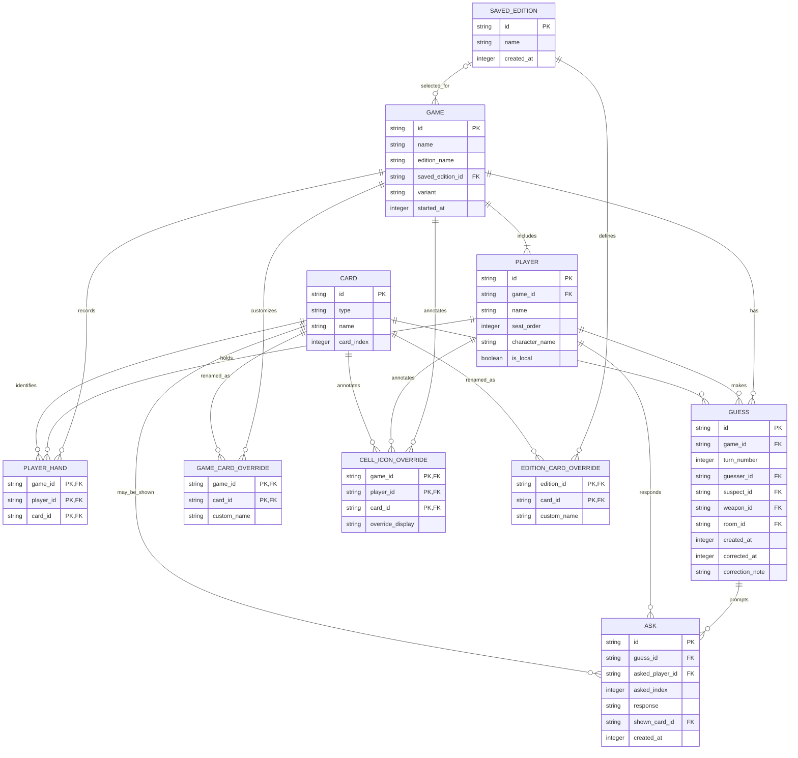
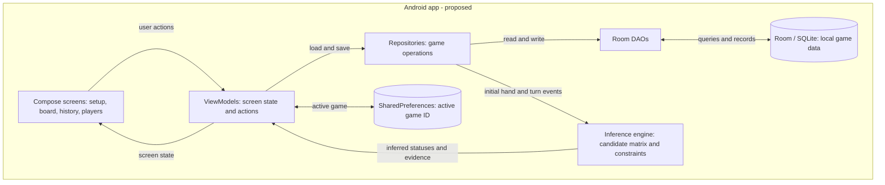

# Clue Companion

> Class project | Android | Kotlin

## Project at a glance

Clue Companion is a planned Android companion app for a game of *Clue*. It helps a player record their starting hand and what happens after each suggestion, then organize that information to narrow down which suspect, weapon, and room may be in the case file.

```text
Set up a game -> Enter your hand -> Record turns -> Track deductions -> Solve the case
```

The design goals documented for the project are:

- Set up a game with a name, players, seat order, and optional character assignments.
- Support standard and custom editions, including reusable card-name customizations.
- Record the local player's initial cards and each suggestion, who was asked, and their response.
- Track cards known, excluded, or still possible for each player, with evidence for inferred statuses.
- Keep a chronological, editable turn history and player profiles.
- Keep game data on the device and make the game work offline.
- Give players a privacy overlay and optional manual cell-icon overrides on the board.

## Current status

The repository contains an Android/Kotlin scaffold and detailed frontend and backend design documents. The documented app flows and inference engine are plans; the Android manifest does not yet register an app screen, and there is no application source under `app/src/main`. The diagrams below describe the proposed project, not implemented behavior.

## Initial ERD

This sketch is based on the persistent tables in [`app/documentation/backend/data-model-and-storage.md`](app/documentation/backend/data-model-and-storage.md). Each game contains players and turns. A guess contains the three suggested cards and the ordered responses (`asks`). Starting-hand, card-name, and cell-display tables associate cards with a game or player. Saved editions are reusable; their card names are copied into a game when selected.



The candidate matrix, evidence trail, and "at least one of these cards" constraints are derived in memory by replaying the hand and turn records. They are not additional persistent tables.

## Rough system design



**Proposed stack from the docs:** Kotlin on Android, Jetpack Compose for the UI, ViewModels for screen state, and Room over SQLite for local persistence. `SharedPreferences` stores the active game ID. There is no server in the proposed architecture. The checked-in Gradle dependencies and source scaffold do not yet implement this design.

## Initial UX sketch

The game-board document describes a two-axis scrollable grid: card labels stay pinned on the left and player names stay pinned at the top. A turn can be logged from the board; tapping a cell opens its evidence and display controls. The intended bottom navigation has Board, History, and Players sections.

```text
+---------------------------------------------------------+
| My Clue Game                                      [Eye] |
| Card / solution    You       Alice      Bob              |
| SUSPECTS                                                |
|   Scarlett          X           X        X              |
|   Peacock           X           %        %              |
| WEAPONS                                                 |
| * Candlestick       X           X        X              |
| ROOMS                                                   |
|   Kitchen           X           X        X              |
|                                                         |
| Board           History           Players     [+ Turn]  |
+---------------------------------------------------------+

Cell display: [blank] = unknown, check = has card,
              X = excluded, % = possible from an unknown reveal
Card label:  check = accounted for, star = confirmed solution
Tap cell -> evidence, inferred display, and optional manual override
Eye toggle -> privacy overlay
```

This is a text wireframe based on [`app/documentation/frontend/game-board.md`](app/documentation/frontend/game-board.md), not an app screenshot. The other UX specs describe setup, initial-hand entry, turn logging, history/editing, and player profiles under [`app/documentation/frontend/`](app/documentation/frontend/).

## Initial daily goals

The documentation does not include the class end date or number of remaining meetings. This draft divides the documented project flow into ten work sessions, starting on the next project work day. Combine or stretch sessions to fit the actual class calendar and reserve the last session for the hand-in or demo.

| Session | Goal | Checkpoint |
|---|---|---|
| 1 | Confirm class requirements and scope; turn the documented game flow and data model into tasks. | Agree on a first-release scope. |
| 2 | Set up the app structure and configure the documented Compose, ViewModel, and Room approach. | A launchable app shell is in place. |
| 3 | Build game setup, including player list, seat order, and edition/card-name options. | Setup flow reflects `start-game.md`. |
| 4 | Add initial-hand entry and persist game, players, hand, and card definitions. | A game and starting hand can be saved. |
| 5 | Build the board grid, card groups, player columns, status cells, and log-turn action. | Board structure reflects `game-board.md`. |
| 6 | Implement turn logging for suggestions, ask order, and the three response types. | Turns are stored as guesses and asks. |
| 7 | Implement inference replay, evidence, uniqueness propagation, and unknown-reveal constraints. | Board statuses update from entered information. |
| 8 | Add history and turn editing; rebuild inference after corrections. | Corrected turns do not leave stale deductions. |
| 9 | Add player profiles and cell details; refine manual overrides and privacy behavior as time allows. | Supporting screens reflect their specs. |
| 10 | Review against the class rubric, fix key gaps, prepare demo data, and finish the hand-in/presentation. | Core project flow is ready to show. |

## Design documentation

- Backend data model and storage: [`app/documentation/backend/data-model-and-storage.md`](app/documentation/backend/data-model-and-storage.md)
- Game setup: [`app/documentation/frontend/start-game.md`](app/documentation/frontend/start-game.md)
- Initial hand: [`app/documentation/frontend/initial-hand.md`](app/documentation/frontend/initial-hand.md)
- Game board: [`app/documentation/frontend/game-board.md`](app/documentation/frontend/game-board.md)
- Turn logging: [`app/documentation/frontend/log-turn.md`](app/documentation/frontend/log-turn.md)
- Turn history and editing: [`app/documentation/frontend/turn-history.md`](app/documentation/frontend/turn-history.md)
- Player profiles: [`app/documentation/frontend/player-profiles.md`](app/documentation/frontend/player-profiles.md)
- Time log: [`time-log.md`](time-log.md)
