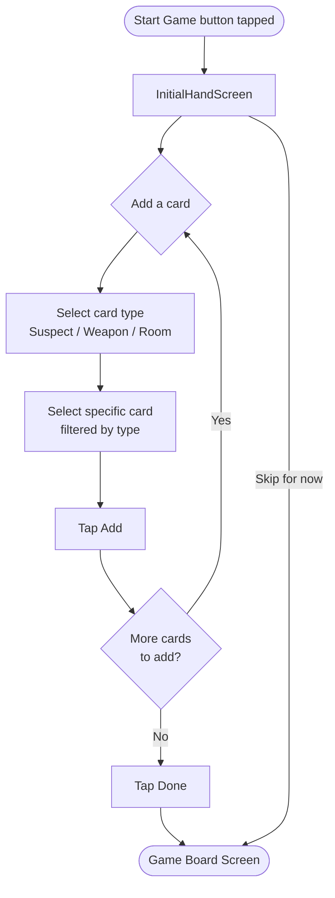

# Frontend: Initial Hand Entry

## Overview

After a game is started, the local player enters the cards they were dealt. This is the first data-entry step before any turns can be logged — the inference engine uses these cards immediately to mark all other players as `EXCLUDED` for each card in the local player's hand.

The screen appears automatically after the "Start Game" action in the setup flow. It can also be reopened from the game board overflow menu in case the player made a mistake.

---

## Screen Flow



---

## Screen Layout

```
┌──────────────────────────────────────────┐
│  Your Starting Cards          [Skip →]   │  ← TopAppBar
├──────────────────────────────────────────┤
│  You should have ~5 cards.               │  ← hint based on player count
│                                          │
│  Your cards:                             │
│  ✓ Scarlett          [Suspect]    [✕]   │
│  ✓ Kitchen           [Room]       [✕]   │
│  ✓ Candlestick       [Weapon]     [✕]   │
│                                          │
│  ─── Add a card ───                      │
│  Type:  [ Suspect         ▾ ]            │
│  Card:  [ Miss Scarlett   ▾ ]            │
│                          [+ Add Card]    │
│                                          │
│                    [Done — Save Cards]   │
└──────────────────────────────────────────┘
```

---

## State Model

```kotlin
data class InitialHandUiState(
    val selectedCards: List<CardSummary>,
    val expectedCardCount: Int,               // hint value; (21 - 3) / playerCount, rounded
    val selectedType: CardType?,              // currently chosen type in the Add section
    val availableCards: List<CardSummary>,    // cards of selectedType not already in selectedCards
    val selectedCard: CardSummary?,           // currently chosen card in the Add section
    val canAdd: Boolean,                      // true when both type and card are selected
    val validationError: String? = null
)
```

`availableCards` is derived: all cards of `selectedType` minus any already in `selectedCards`. This prevents the same card being added twice.

---

## ViewModel

```kotlin
class InitialHandViewModel(
    private val gameId: String,
    private val gameRepository: GameRepository,
    private val inferenceEngine: InferenceEngine
) : ViewModel() {

    val uiState: StateFlow<InitialHandUiState>

    fun onTypeSelected(type: CardType) { ... }
    fun onCardSelected(card: CardSummary) { ... }
    fun onAddCard() { ... }
    fun onRemoveCard(card: CardSummary) { ... }

    // Writes player_hands rows to Room; triggers inference rebuild; navigates to game board
    fun onDone(onSuccess: () -> Unit) { ... }
}
```

`onTypeSelected` resets `selectedCard` to null and recomputes `availableCards` for the new type.

---

## Compose Components

### `InitialHandScreen`

A `Scaffold` with a `TopAppBar` ("Your Starting Cards") containing a **Skip →** text button for players who want to enter cards later. Body is a single scrollable `Column`.

### `CardHintBanner`

A subtle info banner below the app bar:
```
"You should have ~5 cards based on the number of players."
```
Computed as `floor((21 - 3) / playerCount)`. Shown as an approximation since card counts can be uneven.

### `SelectedCardsList`

A `Column` of `SelectedCardRow` items. Each row shows:
- A check icon
- The card's `displayName`
- A small chip showing the card type (`Suspect` / `Weapon` / `Room`)
- A remove button (`✕`) that calls `onRemoveCard`

### `AddCardSection`

Two `ExposedDropdownMenuBox` components followed by an "Add Card" button:

```
Type:  [ Suspect  ▾ ]      ← CardType enum: SUSPECT | WEAPON | ROOM
Card:  [ Scarlett ▾ ]      ← cards of the selected type, excluding already-selected ones
                [+ Add Card]
```

The **+ Add Card** button is disabled (`canAdd = false`) until both dropdowns have a selection. Tapping it calls `onAddCard()`, which appends the card to `selectedCards` and resets both dropdowns.

### `DoneButton`

A full-width primary `Button` at the bottom: **"Done — Save Cards"**.

Disabled if `selectedCards` is empty. Does not block submission if the count differs from `expectedCardCount` — the player may know their exact count differs (uneven deal) — but shows a warning:

```
"You've added N cards. Expected ~M. Tap Done again to confirm."
```

On first tap when count mismatches, shows the warning. On second tap, proceeds.

---

## Validation Rules

| Rule | Behaviour |
|---|---|
| Same card added twice | Prevented — already-selected cards are excluded from the dropdown |
| Zero cards and Done tapped | Shows error: "Add at least one card before saving." |
| Card count differs from expected | Shows warning banner; requires a second Done tap to confirm |
| Skip tapped | Navigates to game board immediately; hand can be filled in later from the overflow menu |

---

## Persistence on Done

`onDone` runs a single Room transaction:

1. Delete any existing `player_hands` rows for `(gameId, localPlayerId)` — handles the re-entry case.
2. Insert one `player_hands` row per card in `selectedCards`.
3. Run `InferenceEngine.applyInitialHand()` — marks each card `KNOWN` for the local player and `EXCLUDED` for all other players via the uniqueness propagation rule.
4. Navigate to `GameBoardScreen`.

---

## Navigation

```
StartGameScreen --[Start Game]---------> InitialHandScreen
InitialHandScreen --[Done / Skip]------> GameBoardScreen
GameBoardScreen --[⋮ Edit my cards]---> InitialHandScreen (re-entry; pre-fills selectedCards)
```

When re-entering from the game board, `selectedCards` is pre-filled from the existing `player_hands` rows. Saving replaces them and triggers a full inference rebuild.

---

## Edit History

- 2026-09-30 1:47 PM — Initial draft created.
