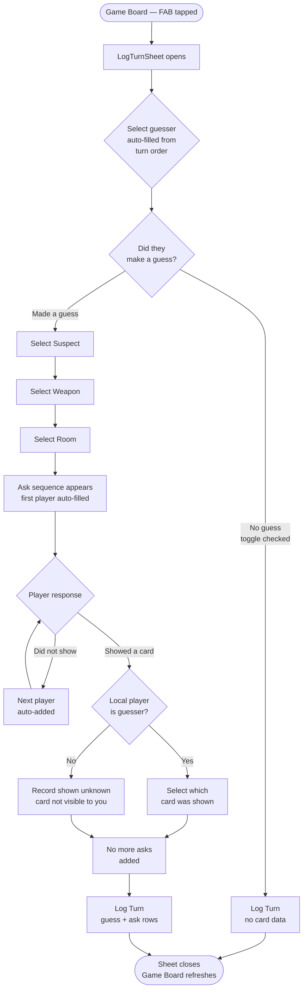

# Frontend: Log a Turn

## Overview

This document covers the "Log a Turn" bottom sheet — the primary data-entry surface during a game. It records who guessed what, which players were asked, and what each player showed (or didn't). On submission it writes a `guesses` row and one `asks` row per player who was asked to Room, then triggers the inference fixpoint loop.

Accessed via the **"+ Log Turn"** FAB on the Game Board screen.

---

## Sheet Flow



---

## State Model

```kotlin
data class CardSummary(
    val id: String,
    val displayName: String    // uses game_card_override name if set
)

data class CardLists(
    val suspects: List<CardSummary>,
    val weapons: List<CardSummary>,
    val rooms: List<CardSummary>
)

sealed class AskResponse {
    // Player was asked and could not show any of the three cards
    object DidNotShow : AskResponse()
    // Player showed a card to the guesser; card is known only if local player was the guesser
    data class ShowedCard(val card: CardSummary?) : AskResponse()
}

data class AskEntry(
    val player: PlayerSummary,
    val response: AskResponse?   // null = not yet filled in by user
)

data class LogTurnUiState(
    val turnNumber: Int,
    val players: List<PlayerSummary>,        // all players in seat order
    val cards: CardLists,
    val guesser: PlayerSummary?,             // pre-filled from turn-order detection
    val madeGuess: Boolean = true,
    val selectedSuspect: CardSummary? = null,
    val selectedWeapon: CardSummary? = null,
    val selectedRoom: CardSummary? = null,
    val askEntries: List<AskEntry> = emptyList(),
    // false once any entry has ShowedCard — asking stops after first reveal
    val canAddMoreAsks: Boolean = true,
    val localPlayerIsGuesser: Boolean = false,
    val validationError: String? = null
)
```

---

## Turn Order Auto-Detection

When the sheet opens, the ViewModel determines the next guesser:

1. Query the `guesses` table for this game, ordered by `turn_number DESC`, take 1.
2. Find that guesser's `seat_order` in the `players` table.
3. Next guesser = player with `seat_order = (lastSeatOrder + 1) % playerCount`.
4. Pre-fill `guesser` with that player. The user can override via the dropdown.

If no guesses have been logged yet (first turn), default to `seat_order = 0`.

---

## Ask Sequence Rules

- Players are asked in **seat order** starting with the player immediately after the guesser (wrapping around).
- The guesser themselves is never in the ask sequence.
- **Asking stops** as soon as one player shows a card — `canAddMoreAsks` becomes false and the "+ Add player asked" button is hidden.
- If no player shows a card, all other players will each have a `DidNotShow` entry.
- The first `AskEntry` is auto-populated with the expected next player in seat order when the guess cards are all selected. Subsequent entries auto-fill the next expected player when the previous entry is set to `DidNotShow`.

---

## ViewModel

```kotlin
class LogTurnViewModel(
    private val gameId: String,
    private val gameRepository: GameRepository,
    private val inferenceEngine: InferenceEngine
) : ViewModel() {

    val uiState: StateFlow<LogTurnUiState>

    fun onGuesserSelected(player: PlayerSummary) { ... }
    fun onMadeGuessToggle(madeGuess: Boolean) { ... }
    fun onSuspectSelected(card: CardSummary) { ... }
    fun onWeaponSelected(card: CardSummary) { ... }
    fun onRoomSelected(card: CardSummary) { ... }

    // Updates the response for an existing ask entry
    fun onAskResponseSet(index: Int, response: AskResponse) { ... }

    // Adds the next expected player as a blank AskEntry
    fun onAddAskEntry() { ... }

    // Validates, writes guesses + asks rows to Room, triggers inference refresh
    fun onSubmit(onSuccess: () -> Unit) { ... }
}
```

---

## Compose Components

### `LogTurnSheet`

Root `ModalBottomSheet`. Contains a scrollable `Column` with all sections and a sticky "Log Turn" button at the bottom.

### `GuesserSection`

```
Whose turn is it?
[ Alice           ▾ ]    ← DropdownMenu of all players
```

Dropdown listing all players. Pre-filled by turn-order detection. Changing it resets `askEntries` (seat order changes relative to the new guesser).

### `NoGuessToggle`

```
[ ] No guess this turn  (player didn't reach a room)
```

A `Checkbox` row. When checked, the Suspect / Weapon / Room dropdowns and ask sequence section collapse and disappear. The turn is still logged as a `guesses` row with null card IDs.

### `GuessCardsSection`

Three `ExposedDropdownMenuBox` components stacked vertically:

```
Suspect:  [ Miss Scarlett     ▾ ]
Weapon:   [ Candlestick       ▾ ]
Room:     [ Library           ▾ ]
```

Each dropdown lists only the cards of its type using `displayName` (respects custom edition names). All three must be selected before the ask sequence section appears.

### `AskSequenceSection`

Appears once all three guess cards are selected. Header label: "Who was asked?"

Contains a `Column` of `AskEntryRow` items plus an **"+ Add player asked"** `TextButton` at the bottom. The add button is hidden once `canAddMoreAsks = false`.

### `AskEntryRow`

One row per player who was asked. Layout:

```
Bob:  [ Did not show  ▾ ]
```

or, if "Showed a card" is selected and the local player IS the guesser:

```
Bob:  [ Showed a card ▾ ]   Which card?  [ Candlestick ▾ ]
```

or, if "Showed a card" is selected and the local player is NOT the guesser:

```
Bob:  [ Showed a card ▾ ]   (card unknown to you)
```

The player label is read-only (auto-filled in seat order). The response dropdown has two options:
- **Did not show** — maps to `AskResponse.DidNotShow`
- **Showed a card** — maps to `AskResponse.ShowedCard`

If "Showed a card" and `localPlayerIsGuesser = true`, a second dropdown appears listing the three guessed cards for the user to select which one was shown.

When an entry is set to "Showed a card", `canAddMoreAsks` becomes false and no further entries can be added.

---

## Validation Rules

| Rule | Error message |
|---|---|
| No guesser selected | "Select whose turn it is." |
| Made a guess but not all three cards selected | "Select a suspect, weapon and room." |
| Made a guess but ask sequence is empty | "Add at least one ask entry (or mark as no-show)." |
| Ask entries are out of seat order | "Players must be asked in seat order." |
| Same player appears twice in ask sequence | "Each player can only appear once." |

Errors appear as a `Snackbar` or inline label above the Log Turn button.

---

## Persistence on Submit

`onSubmit` runs a single Room transaction:

1. Insert a `guesses` row: `(gameId, turnNumber, guesserId, suspectId, weaponId, roomId, createdAt)`. If `madeGuess = false`, card IDs are null.
2. For each `AskEntry` (in order), insert an `asks` row:
   - `response = "none"` for `DidNotShow`
   - `response = "shown"` + `shownCardId` for `ShowedCard` when card is known
   - `response = "shown_unknown"` for `ShowedCard` when card is unknown
3. Call `InferenceEngine.applyNewEvents()` to update the in-memory candidate matrix.
4. Call `GameBoardViewModel.refreshInference()` so the grid updates immediately.

---

## Navigation

```
GameBoardScreen --[FAB tap]----------> LogTurnSheet (bottom sheet, overlaid)
LogTurnSheet    --[Log Turn / cancel]-> GameBoardScreen (sheet dismisses, grid refreshes)
```

---

## Edit History

- 2026-09-30 11:30 AM — Initial draft created.
