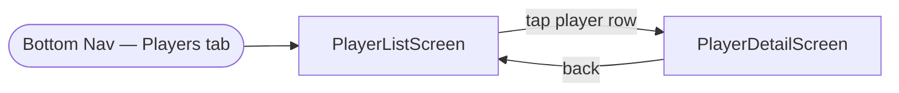

# Frontend: Player Profiles

## Overview

The Player Profiles section has two screens: a **Player List** screen showing all players in the game, and a **Player Detail** screen with a full breakdown of what a player has done and what is known about them.

Accessed via a **"Players"** tab in the bottom navigation bar.

---

## Navigation



---

## Screen 1: Player List

Shows all players in seat order. Each row summarises what is currently known about that player.

### Layout

```
┌──────────────────────────────────────────┐
│  Players                                 │  ← TopAppBar
├──────────────────────────────────────────┤
│  You (Miss Scarlett)       3 cards known │  ← local player highlighted
│  Alice (Col. Mustard)      1 card known  │
│  Bob                       0 cards known │
│  Carol (Mrs. Peacock)      2 cards known │
└──────────────────────────────────────────┘
```

### State Model

```kotlin
data class PlayerListUiState(
    val players: List<PlayerRowSummary>      // ordered by seat_order
)

data class PlayerRowSummary(
    val id: String,
    val name: String,
    val characterName: String?,              // null if not set at game setup
    val seatOrder: Int,
    val knownCardCount: Int,                 // count of KNOWN cells for this player
    val isLocalPlayer: Boolean
)
```

### Component: `PlayerListScreen`

A `Scaffold` with a `TopAppBar` ("Players") and a `LazyColumn` of `PlayerRow` items.

### Component: `PlayerRow`

```
[ avatar / initial ]  Name (Character)          N cards known  >
```

- Left: a circular avatar showing the player's initial (or character colour if set).
- Centre: player name, character name in parentheses if set.
- Right: `"N cards known"` count + chevron.
- Local player row has a distinct tint or label ("You").
- Tapping the row navigates to `PlayerDetailScreen(playerId)`.

---

## Screen 2: Player Detail

Three sections on one scrollable screen: known cards, guesses this player made, and a full chronological turn history.

### Layout

```
┌──────────────────────────────────────────┐
│  [← Back]  Alice (Col. Mustard)          │  ← TopAppBar
├──────────────────────────────────────────┤
│  KNOWN CARDS                             │
│  • Mustard                               │
│                                          │
│  SUSPECTED CARDS                         │
│  % Rope     (1 of 2 remaining)  ▾        │  ← one row per possible card
│  % Library  (1 of 2 remaining)  ▾        │
│    Turn 7: Bob guessed Plum/Rope/Library.│  ← expanded explanation (shared)
│    Plum is ruled out for Alice,          │
│    so Alice has Rope or Library.         │
│                                          │
│  THEIR GUESSES                           │
│  Turn 4  Scarlett / Knife / Library      │
│           Bob showed them a card         │
│  Turn 9  Plum / Rope / Kitchen           │
│           Nobody showed                  │
│                                          │
│  TURN HISTORY                            │
│  Turn 2  Could not show Scarlett,        │
│           Knife or Library  (You guessed)│
│  Turn 4  Made a guess — Scarlett,        │
│           Knife / Library. Bob showed.   │
│  Turn 7  Showed a card from Plum,        │
│           Rope or Library  (Bob guessed) │
└──────────────────────────────────────────┘
```

### State Model

```kotlin
data class PlayerDetailUiState(
    val player: PlayerRowSummary,
    val knownCards: List<CardSummary>,           // cards where this player's status = KNOWN
    val suspectedCards: List<SuspectedCardItem>, // cards where an active constraint points here
    val guesses: List<GuessSummary>,             // turns where this player was the guesser
    val turnHistory: List<TurnHistoryItem>       // all turns this player was involved in
)

// One entry per card that has at least one active constraint involving this player
data class SuspectedCardItem(
    val card: CardSummary,
    val probability: Float?,                 // null if probabilistic scoring is off
    val constraints: List<ConstraintExplanation>
)

data class ConstraintExplanation(
    val turnNumber: Int,
    val guesser: PlayerSummary,
    val originalCards: List<CardSummary>,    // the three cards in the original guess
    val remainingCards: List<CardSummary>,   // cards in the constraint not yet ruled out
    val askId: String?                       // links to history tab entry
) {
    // Human-readable reason string, built in ViewModel
    // e.g. "Turn 7: Bob guessed Plum / Rope / Library. Plum is ruled out, so Alice has Rope or Library."
}

data class GuessSummary(
    val turnNumber: Int,
    val suspect: CardSummary,
    val weapon: CardSummary,
    val room: CardSummary,
    val shownBy: PlayerSummary?,             // null = nobody showed a card
    val shownCard: CardSummary?              // null = card shown but unknown to you
)

sealed class TurnHistoryItem {
    // This player made a guess
    data class MadeGuess(
        val turnNumber: Int,
        val suspect: CardSummary,
        val weapon: CardSummary,
        val room: CardSummary,
        val shownBy: PlayerSummary?,
        val shownCard: CardSummary?
    ) : TurnHistoryItem()

    // This player was asked and could not show any card
    data class CouldNotShow(
        val turnNumber: Int,
        val guesser: PlayerSummary,
        val suspect: CardSummary,
        val weapon: CardSummary,
        val room: CardSummary
    ) : TurnHistoryItem()

    // This player showed a card in response to a guess
    data class ShowedCard(
        val turnNumber: Int,
        val guesser: PlayerSummary,
        val suspect: CardSummary,
        val weapon: CardSummary,
        val room: CardSummary,
        val shownCard: CardSummary?          // null = shown to someone else, card unknown to you
    ) : TurnHistoryItem()

    // This player's turn but they did not reach a room
    data class NoGuess(
        val turnNumber: Int
    ) : TurnHistoryItem()
}
```

### ViewModel

```kotlin
class PlayerDetailViewModel(
    private val gameId: String,
    private val playerId: String,
    private val gameRepository: GameRepository,
    private val inferenceEngine: InferenceEngine
) : ViewModel() {
    val uiState: StateFlow<PlayerDetailUiState>
}
```

`uiState` is built by:
1. Loading the player row from `players`.
2. Querying the candidate matrix for all `KNOWN` cells belonging to this player → `knownCards`.
3. Finding all active `Constraint` objects for this player in the inference engine → for each constraint, build a `SuspectedCardItem` per card still in `constraint.cardIds`, with a `ConstraintExplanation` formatted as a human-readable sentence. Cards already in `knownCards` are excluded. → `suspectedCards`.
4. Querying `guesses` where `guesser_id = playerId`, joining `asks` to find the first positive reveal → `guesses`.
5. Building `turnHistory` by querying all `guesses` and `asks` rows that reference this player (as guesser, asked player, or showing player), sorted by `turn_number`.

---

## Compose Components

### `PlayerDetailScreen`

A `Scaffold` with a `TopAppBar` (player name + character name) and a `LazyColumn` body with four sections separated by `Divider`s and sticky `SectionHeader`s.

### `KnownCardsSection`

Renders `knownCards` as a simple vertical list of card display names with a card-type icon (suspect / weapon / room). If `knownCards` is empty, shows `"No confirmed cards yet."`.

### `SuspectedCardsSection`

Renders `suspectedCards` as an expandable list. Each `SuspectedCardItem` is a row showing the card name prefixed with `%`, an optional probability badge (`"72%"`) if `probability != null`, and an expand/collapse chevron.

Expanding a row reveals the constraint explanations — one paragraph per `ConstraintExplanation`:

```
% Library  [72%]  ▾
  Turn 7: Bob guessed Plum / Rope / Library.
  Plum is ruled out for Alice, so Alice has Rope or Library.
  [View turn →]                               ← disabled until history tab ships
```

The explanation sentence is built from `ConstraintExplanation` fields:
- If `remainingCards.size == 1`: `"[Original cards minus one] are ruled out, so [player] must have [remaining card]."`
- If `remainingCards.size == 2`: `"[Excluded card] is ruled out, so [player] has [remaining1] or [remaining2]."`
- If `remainingCards.size == 3`: `"[Player] showed a card — all three are still possible."`

If `suspectedCards` is empty, shows `"No active constraints — no suspected cards yet."`.

### `GuessesSection`

Each `GuessSummary` renders as a card:

```
Turn 4 — Scarlett / Knife / Library
  Bob showed them a card
```

or:

```
Turn 9 — Plum / Rope / Kitchen
  Nobody showed
```

### `TurnHistorySection`

Each `TurnHistoryItem` renders as a compact list row with a leading icon indicating the item type:

| Item type | Leading icon | Summary text |
|---|---|---|
| `MadeGuess` | 🔍 | "Made a guess — Scarlett / Knife / Library" |
| `CouldNotShow` | ✗ | "Could not show (You guessed Scarlett / Knife / Library)" |
| `ShowedCard` (card known) | ✓ | "Showed you Mustard (Bob guessed Scarlett / Knife / Library)" |
| `ShowedCard` (card unknown) | ✓ | "Showed a card (Bob guessed Scarlett / Knife / Library)" |
| `NoGuess` | — | "No guess this turn" |

Items are sorted chronologically (ascending `turnNumber`). Tapping a row with a linked `askId` will navigate to the history tab detail view (not yet implemented — link disabled until history tab ships).

---

## Edit History

- 2026-09-30 12:12 PM — Initial draft created.
- 2026-09-30 1:22 PM — Added Suspected Cards section with constraint explanations and probability badge.
