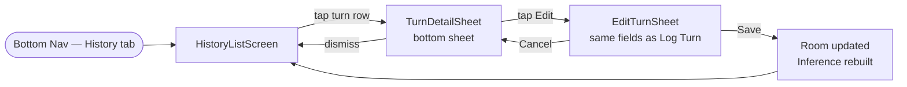

# Frontend: Turn History & Edit

## Overview

The History screen shows every logged turn in chronological order and lets a player correct a turn they entered incorrectly. Editing a turn updates the underlying `guesses` and `asks` rows in Room, then rebuilds the entire in-memory inference matrix by replaying all events from scratch — this is the source of truth for constraints, so no separate constraint history is needed.

Accessed via a **"History"** tab in the bottom navigation bar.

---

## Navigation



---

## Screen 1: History List

Chronological list of every logged turn. Each row gives a one-line summary of what happened.

### Layout

```
┌──────────────────────────────────────────┐
│  Turn History                            │  ← TopAppBar
├──────────────────────────────────────────┤
│  Turn 1   You — Scarlett/Knife/Library   │
│           Alice showed you a card        │
│  Turn 2   Alice — no guess this turn     │
│  Turn 3   Bob — Plum/Rope/Kitchen        │
│           Nobody showed            ✎    │  ← ✎ = corrected turn badge
│  Turn 4   Carol — Plum/Rope/Kitchen      │
│           You showed a card              │
│  ...                                     │
└──────────────────────────────────────────┘
```

Turns that have been corrected show a small edit badge (✎) so the player can see the history has been revised.

### State Model

```kotlin
data class HistoryListUiState(
    val turns: List<TurnSummaryItem>
)

data class TurnSummaryItem(
    val guessId: String,
    val turnNumber: Int,
    val guesserName: String,
    val summary: String,          // pre-formatted one-liner (see Summary Formatting below)
    val wasCorrected: Boolean     // true if corrected_at is non-null on the guesses row
)
```

### Summary Formatting

| Scenario | Summary text |
|---|---|
| Made a guess, someone showed | `"[Guesser] — [Suspect]/[Weapon]/[Room]. [Shower] showed a card."` |
| Made a guess, you showed | `"[Guesser] — [Suspect]/[Weapon]/[Room]. You showed a card."` |
| Made a guess, nobody showed | `"[Guesser] — [Suspect]/[Weapon]/[Room]. Nobody showed."` |
| No guess | `"[Guesser] — no guess this turn."` |

### Components

**`HistoryListScreen`** — `Scaffold` with `TopAppBar` and `LazyColumn`. Each item is a `TurnSummaryRow` that opens `TurnDetailSheet` on tap.

**`TurnSummaryRow`** — two-line row: turn number + summary text. Trailing `✎` badge when `wasCorrected = true`.

---

## Screen 2: Turn Detail Sheet

A `ModalBottomSheet` opened when a row is tapped. Shows the full turn record and an **Edit** button.

### Layout

```
Turn 3 — Bob                         ✎ Corrected
──────────────────────────────────────────────────
Guess:  Plum / Rope / Kitchen

Asked:
  You       — Could not show
  Alice     — Could not show
  Carol     — Showed a card  (card unknown to you)

                              [Edit this turn]
```

### State Model

```kotlin
data class TurnDetailUiState(
    val guessId: String,
    val turnNumber: Int,
    val guesserName: String,
    val madeGuess: Boolean,
    val suspect: CardSummary?,
    val weapon: CardSummary?,
    val room: CardSummary?,
    val askDetails: List<AskDetailItem>,
    val wasCorrected: Boolean,
    val correctedAt: Long?              // epoch ms of last correction, null if never edited
)

data class AskDetailItem(
    val playerName: String,
    val response: AskResponse           // DidNotShow | ShowedCard(card?)
)
```

---

## Edit Turn Flow

Tapping **"Edit this turn"** opens `EditTurnSheet` — identical to `LogTurnSheet` but pre-filled with the existing turn data. The guesser dropdown is also editable in case the wrong person was selected.

### What "Save" does

`EditTurnViewModel.onSave()` runs a single Room transaction:

1. Update the `guesses` row: overwrite `guesser_id`, `suspect_id`, `weapon_id`, `room_id`; set `corrected_at = now()`.
2. Delete all existing `asks` rows for this `guess_id`.
3. Insert the new `asks` rows from the edited ask sequence.
4. **Rebuild inference from scratch** — see section below.
5. Persist any `cell_icon_overrides` that are still valid (overrides for cells now marked `KNOWN` or `EXCLUDED` are cleared automatically since they would conflict with confirmed data).

### EditTurnViewModel

```kotlin
class EditTurnViewModel(
    private val gameId: String,
    private val guessId: String,
    private val gameRepository: GameRepository,
    private val inferenceEngine: InferenceEngine
) : ViewModel() {

    // Pre-filled from existing guesses/asks rows
    val uiState: StateFlow<LogTurnUiState>

    // Same action handlers as LogTurnViewModel
    fun onGuesserSelected(player: PlayerSummary) { ... }
    fun onMadeGuessToggle(madeGuess: Boolean) { ... }
    fun onSuspectSelected(card: CardSummary) { ... }
    fun onWeaponSelected(card: CardSummary) { ... }
    fun onRoomSelected(card: CardSummary) { ... }
    fun onAskResponseSet(index: Int, response: AskResponse) { ... }
    fun onAddAskEntry() { ... }

    // Deletes old asks, writes new ones, sets corrected_at, rebuilds inference
    fun onSave(onSuccess: () -> Unit) { ... }
}
```

---

## Inference Rebuild on Edit

Because constraints are entirely **derived** from the event log, no separate constraint history is needed. Editing a turn triggers a full replay:

```
1. Clear the in-memory candidate matrix and constraint list entirely.
2. Re-initialize all (player, card) candidates to POSSIBLE.
3. Replay every guesses + asks row for this game in turn_number order,
   applying the deduction fixpoint loop after each event exactly as on first load.
4. The resulting matrix and constraint list are the correct post-edit state.
```

This replay is cheap — a typical game has ≤ 30 turns and ≤ 21 cards × 6 players = 126 cells. It completes in milliseconds.

After rebuild, emit a new `GameBoardUiState` so the grid and player profiles update automatically via their shared `Flow`.

---

## Data Model Changes

Two columns added to the `guesses` table to track corrections:

| Column | Type | Notes |
|---|---|---|
| `corrected_at` | INTEGER NULLABLE | Epoch ms of the most recent edit; null = never corrected |
| `correction_note` | TEXT NULLABLE | Optional free-text note the user can add explaining what they fixed |

These columns require a Room migration (schema version bump).

No separate constraint history table is needed — the event log is the source of truth and constraints are always rebuilt from it.

---

## Validation on Edit

Same rules as Log Turn, plus:

| Rule | Error message |
|---|---|
| Edited guesser conflicts with a future turn's ask sequence player order | "Changing the guesser may affect later turns — review the turns below." (warning, not a block) |
| All three guess cards removed but `madeGuess` still true | "Select a suspect, weapon and room, or mark as no guess." |

---

## Edit History

- 2026-09-30 1:26 PM — Initial draft created.
